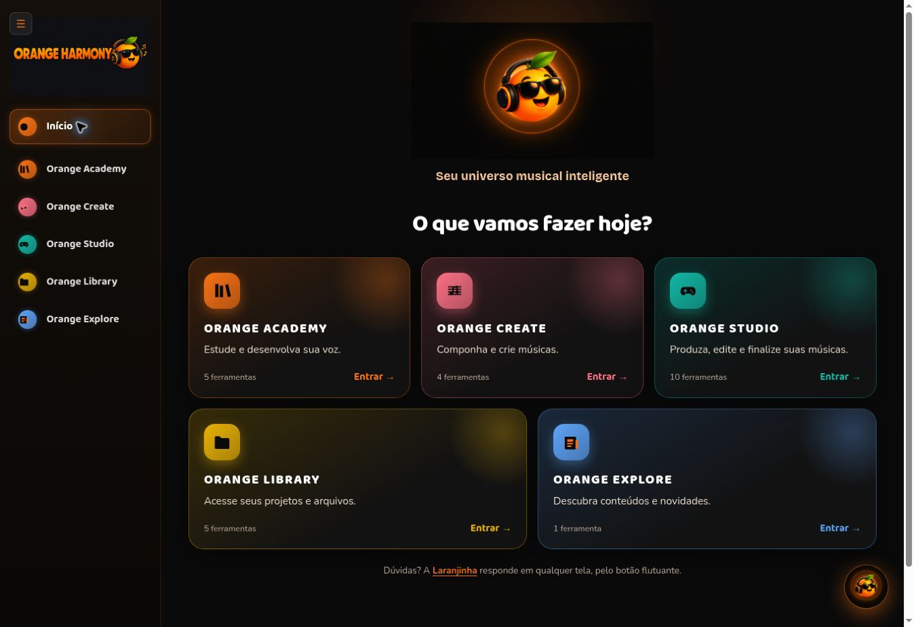
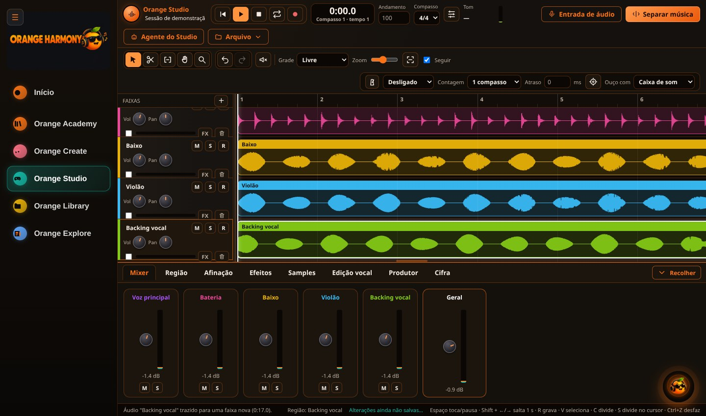
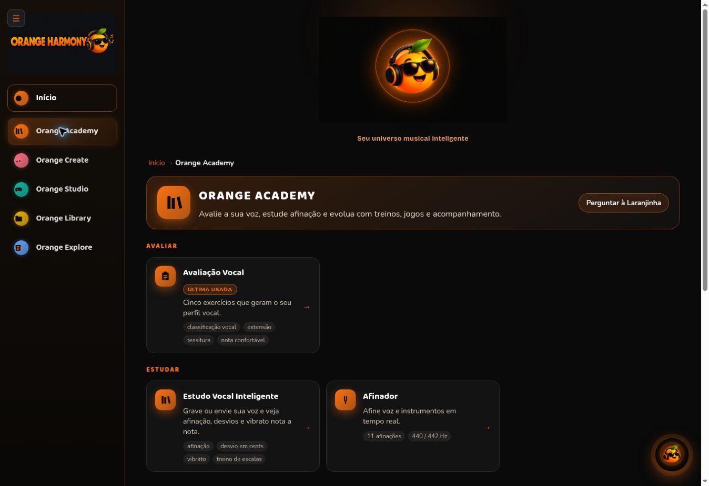
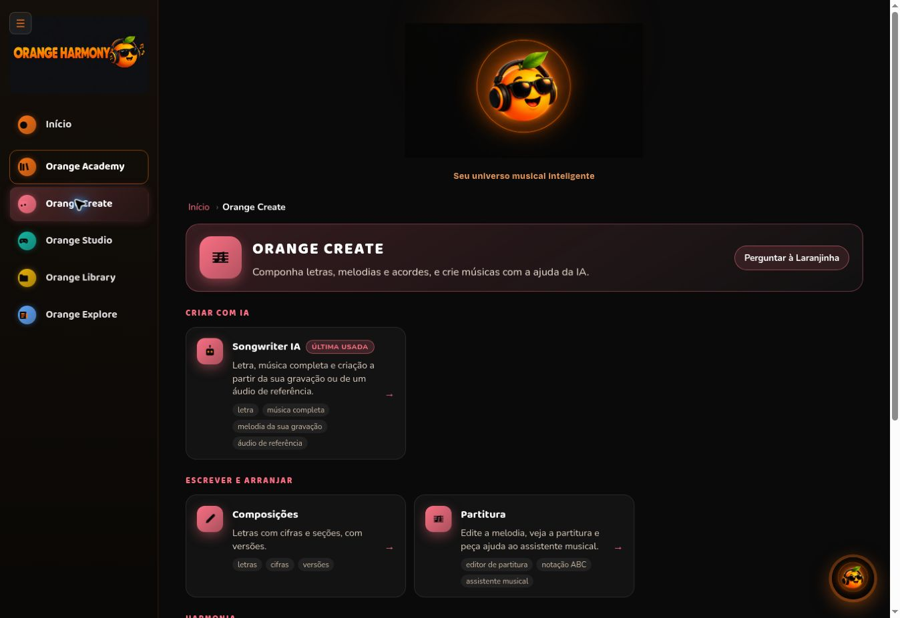
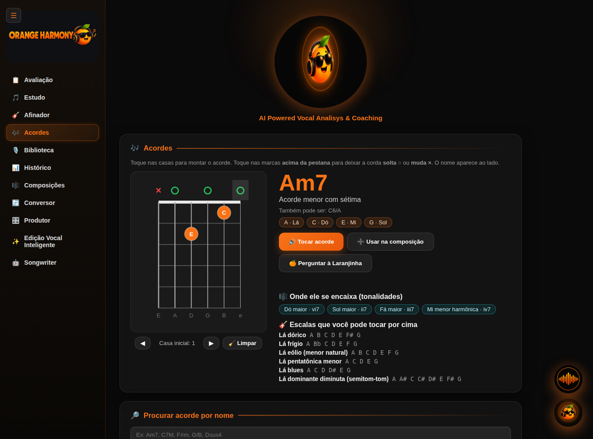
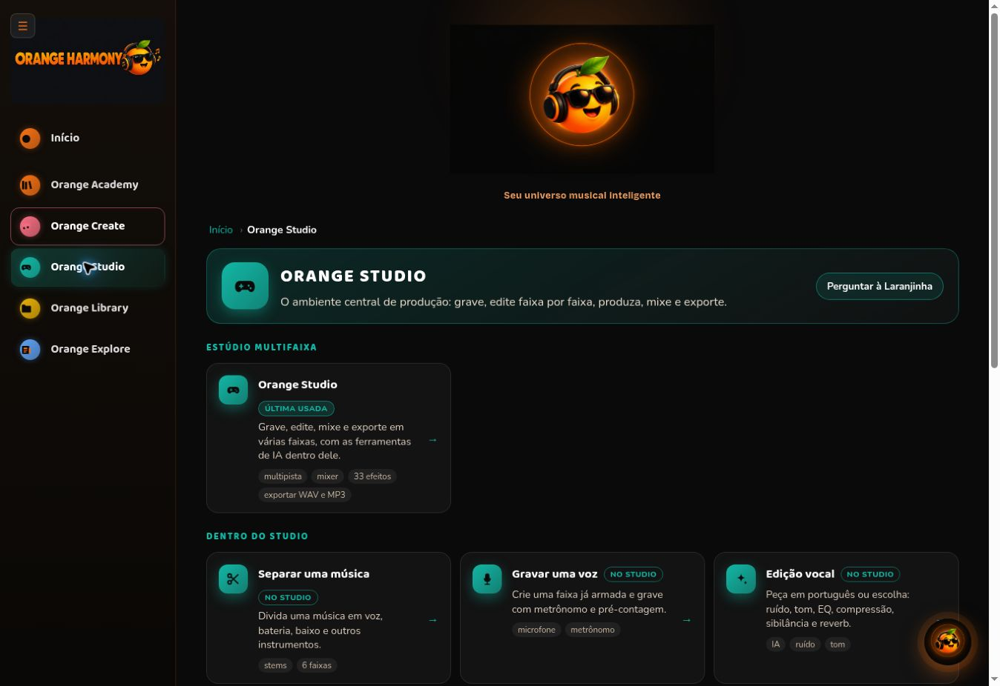
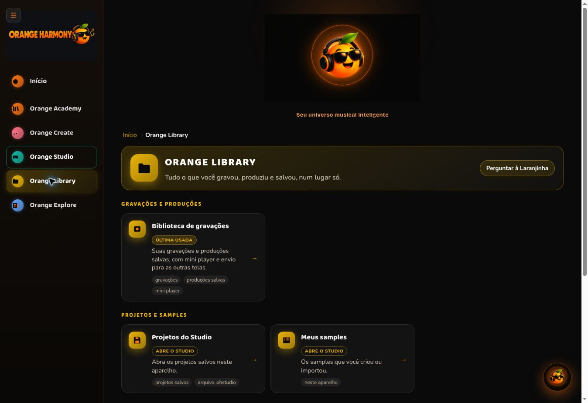
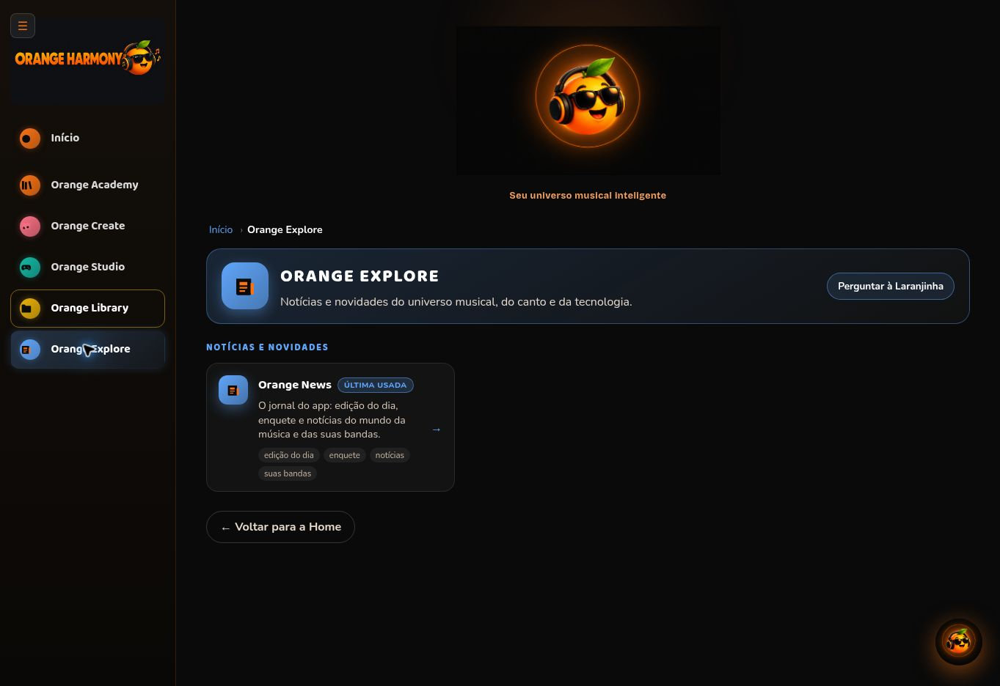
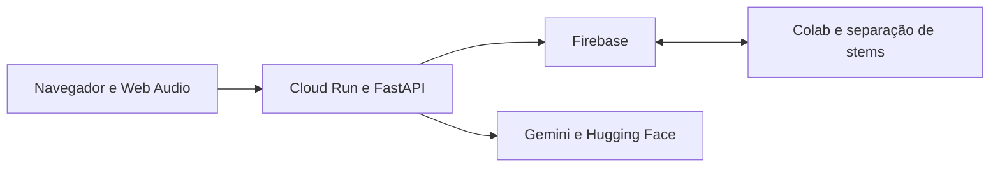

# Orange Harmony

**Plataforma autoral para aprender a cantar, compor e produzir música no navegador.**

O Orange Harmony reúne avaliação vocal, composição com IA e um estúdio multifaixa. Você pode estudar uma melodia, desenvolver uma composição, gravar por cima de uma base e finalizar a mix no mesmo aplicativo.

[Abrir o Orange Harmony](https://orange-harmony-36127841485.us-central1.run.app/) · [Conhecer os ambientes](#ambientes) · [Ver o fluxo técnico](#arquitetura)



## Ambientes

| Ambiente | O que você pode fazer |
| --- | --- |
| **Orange Academy** | Fazer a avaliação vocal em cinco exercícios, consultar extensão e tessitura, treinar escalas, acompanhar a afinação em tempo real e ver o histórico. O Singergame inclui treino livre, por escala e vocalise. |
| **Orange Create** | Escrever letras com cifras e versões, gerar ideias ou músicas com o Songwriter, editar partituras em notação ABC com reprodução e explorar acordes no braço do violão. |
| **Orange Studio** | Gravar em múltiplas faixas, editar regiões, corrigir afinação, criar backings, gerar acompanhamento, aplicar efeitos, mixar e exportar. Também reúne análise de cifra e letra, samples e conversão de áudio. |
| **Orange Library** | Reabrir gravações e produções na biblioteca e acessar composições e histórico. Projetos do Studio e samples ficam no navegador. O projeto pode ser exportado em `.ohstudio`. |
| **Orange Explore** | Consultar o Orange News, com edição do dia, dicas, notícias de música e enquetes. |

A **Laranjinha** ajuda com tarefas musicais e de organização. Dentro do Studio, o **Agente do Studio** propõe ações para a faixa ou o trecho antes de aplicar a edição.

## Por dentro do Orange Studio



- **Gravação e edição** com overdub, metrônomo, pré-contagem, seleção de trecho, fades, corte com reencaixe e histórico de desfazer. **Espaço** toca ou pausa. **Shift + ←/→** desloca a reprodução em um segundo.
- **Afinação e produção** com correção de voz no editor, ajuste de BPM por faixa ou no projeto e geração de acompanhamento em faixas separadas. O Produtor oferece estilos com bateria, baixo, acordes, teclado e solo.
- **Backing vocals** com Dobra, Harmonia e Coro a partir de um trecho, além de Vocalize para gravar. É possível criar até três faixas de apoio e ajustar cada uma no mixer.
- **Mixagem** com volume e panorama em controles giratórios, efeitos por faixa, solo, mute individual, em grupo e geral. No mute geral, você pode reativar uma faixa e ouvir só o que liberou. Ao sair desse modo, o Studio restaura os mutes anteriores.
- **Stems e exportação** com separação de voz e instrumental, modo de seis faixas e modo de voz principal, backings agrupados e instrumental. A exportação oferece mix ou faixas separadas, em WAV ou MP3. A validação do novo separador com o modelo real no Colab e a extração de backings individuais estão pendentes.

## Galeria

<details>
<summary>Orange Academy e Orange Create</summary>

| Orange Academy | Orange Create |
| --- | --- |
|  |  |



</details>

<details>
<summary>Orange Studio, Library e Explore</summary>



| Orange Library | Orange Explore |
| --- | --- |
|  |  |

</details>

## Arquitetura

A branch `cloudrun` contém a versão documentada aqui. No Cloud Run, o FastAPI serve a interface e a API pelo mesmo endereço. O Studio usa Web Audio API para reprodução e processamento local. O aplicativo usa Firestore e Cloud Storage for Firebase para dados e arquivos das funções conectadas.



| Camada | Tecnologia e uso |
| --- | --- |
| Interface | HTML, CSS e JavaScript, Web Audio API, abcjs para partitura, SoundTouchJS para transposição e IndexedDB para projetos e samples do Studio. |
| API e áudio | Python 3.12, FastAPI, Uvicorn, NumPy, SciPy, librosa, SoundFile e FFmpeg. |
| IA | Gemini para devolutivas e assistentes. Hugging Face para geração musical. Demucs para stems e Mel-Band RoFormer no modo de backings. |
| Dados e operação | Firestore para registros e fila de stems, Cloud Storage para arquivos e Cloud Run para a aplicação. O worker do Colab processa a fila quando está ligado. |

## Executar localmente

Use Python 3.12. A partir da raiz do repositório, no **PowerShell**:

```powershell
cd backend
py -3.12 -m venv .venv
.\.venv\Scripts\python.exe -m pip install -r requirements.txt
.\.venv\Scripts\python.exe -m uvicorn main:app --reload --port 8000
```

No **macOS ou Linux**:

```bash
cd backend
python3.12 -m venv .venv
.venv/bin/python -m pip install -r requirements.txt
.venv/bin/python -m uvicorn main:app --reload --port 8000
```

Abra [localhost:8000](http://localhost:8000). A rota `/api/health` permite verificar se a API iniciou. Configure as variáveis no ambiente antes de iniciar o servidor para usar os recursos que dependem dos serviços externos.

| Variável | Uso |
| --- | --- |
| `GEMINI_API_KEY` | Professor de IA, Laranjinha e outras funções de texto. |
| `HF_TOKEN` | Geração musical no Hugging Face. |
| `FIREBASE_STORAGE_BUCKET` | Bucket do Firebase Storage. |
| `GOOGLE_APPLICATION_CREDENTIALS_JSON` | Credencial em JSON para ambientes que a exigem. No Cloud Run, prefira a identidade da conta de serviço com as permissões do projeto. |
| `COLAB_SEPARADOR_URL` | Opcional. Personaliza o link para o notebook do separador. |

Mantenha chaves e arquivos de credenciais fora do repositório.

## Deploy e separação de stems

- O [Dockerfile](https://github.com/campregherpaulo92/orange-harmony/blob/cloudrun/Dockerfile) monta a interface e a API para o Cloud Run. A versão em uso é implantada a partir da branch `cloudrun`. Depois de publicar, verifique a inicialização em `/api/health` e abra o Studio pelo endereço do app.
- No Colab, abra [o notebook do separador](https://github.com/campregherpaulo92/orange-harmony/blob/cloudrun/notebooks/separador_stems.ipynb), configure o segredo `FIREBASE_JSON` ou use o seletor de arquivo oferecido pelo notebook, e execute as células. Deixe a última rodando enquanto usar a separação. O Studio indica quando o worker está ligado.
- Com **GitHub privado**, abra o notebook com uma conta autorizada a ver o repositório ou use uma cópia privada no Drive. A variável `COLAB_SEPARADOR_URL` permite apontar o botão do Studio para o notebook escolhido. Confira também se a conexão do Cloud Build continua autorizada a ler a branch.
- A visibilidade do código no GitHub e o acesso ao aplicativo no Cloud Run são configurações independentes.

## Estrutura do repositório

| Caminho | Responsabilidade |
| --- | --- |
| [`frontend/`](frontend/) | Aplicativo web, ambientes, ferramentas musicais, projeto multifaixa e processamento local. |
| [`backend/`](backend/) | API, avaliação e análise de áudio, teoria musical, geração, integração de IA e persistência. |
| [`notebooks/`](notebooks/) | Notebook e worker que processam a fila de stems. |
| [`screenshots/`](screenshots/) | Capturas da interface usadas na documentação. |
| [`app.py`](app.py) | Aplicação Streamlit anterior, mantida como referência. |

## Histórico

As atualizações recentes do Studio incluíram edição por intervalo, backing vocals, ajuste de andamento, atalhos de reprodução, controles giratórios, padronização dos ícones e mute geral com exceções por faixa.

<details>
<summary>Histórico das versões anteriores</summary>

**v16 — a produção acompanha a sua melodia**
- Harmonia automática: o app descobre o tom (maior/menor) e escolhe os acordes de cada compasso a partir da melodia cantada ou tocada; baixo, teclado e acordes seguem essa harmonia (antes a sequência era fixa por estilo e combinava com só ~1/3 da melodia)
- Dinâmica: a banda toca mais forte ou mais fraca conforme o volume da voz
- Detecção de andamento corrigida para melodias sem percussão (antes devolvia sempre 90 BPM); campo opcional para informar o BPM
- A tela mostra o tom e os acordes escolhidos

**v15 — ritmos de verdade**
- A Produção ganha **270 estilos** em 21 grupos (antes 20, e só o tamanho do acorde mudava de um para outro): samba, pagode, bossa nova, forró, baião, axé, sertanejo, funk carioca, pop rock, rock, metal, jazz, blues, reggae, salsa, eletrônica e muitos mais
- Cada estilo tem bateria, baixo e acordes próprios, sobre a grade da batida detectada na gravação (e acompanha oscilação de andamento)
- A lista de estilos agora vem do servidor, em grupos, e é a mesma na Produção e no Songwriter (antes a tela tinha uma lista antiga de 12)
- O Songwriter envia ao Gemini a descrição de cada estilo
- Mixagem da produção nivelada pelo volume médio de cada camada em relação à sua voz (antes pelo pico, o que deixava a bateria uns 20 dB abaixo da voz e todos os estilos soando iguais)

**v14 — Vocalise**
- Novo modo do Singergame: o piano toca o padrão, depois é a sua vez (sem som na sua vez, então não precisa de fone)
- Padrões escadinha, arpejo e terça; velocidades lenta, média e rápida; o padrão sobe meio tom por rodada e volta
- Cada nota é julgada pelo centro do que foi cantado, com a margem da dificuldade escolhida

**v13 — análise nota por nota**
- O desvio e o % afinado passam a ser medidos **nota por nota**, como um afinador (antes tudo era comparado a uma nota só, e uma escala perfeita saía como "desafinada")
- A nota de referência só vale quando "Nota de referência" está marcada
- Novo cartão **Nota por nota** na análise; o Professor recebe o detalhe de cada nota e o último exercício que passou, sem penalizar quem canta outra coisa
- Histórico: análises antigas marcadas com ⚠️ e fora do gráfico de evolução

**v12 — Singergame**
- Nova aba **Singergame**: jogo de afinação (túnel com anéis, modo Livre e modo Escala), com afinômetro em tempo real e tolerância em cents por dificuldade
- Reaproveita a detecção de pitch do Afinador e o perfil vocal da Avaliação
- Efeitos sonoros sintetizados (sem arquivo de áudio) e recorde salvo no Firestore

**v11 — Orange News**
- Nova aba **Newsletter** (Orange News): jornal com edição diária e notícias de fora com resumo em português
- Correção de layout no celular: nenhuma aba passa mais da largura da tela

**v10 — treino de escalas**
- Seletor de escala na aba Estudo (12 escalas, qualquer tônica), com notas, graus, acordes da escala e desafio de canto
- Botão de tocar a escala no piano, subindo e descendo
- Avaliação da gravação na escala escolhida, com o Professor e a Laranjinha cientes dela
- O histórico passa a guardar a escala treinada

**v9 — hospedagem e acordes**
- Migração para o Render, com monitor de 5 min contra o sono do servidor
- Separador de stems via Colab, comunicando pelo Firebase (card visual, detecção automática)
- Nova aba **Acordes**, com ferramentas na Laranjinha
- Análise, produção e edição em blocos e limitadas a 120 s, para caber em 512 MB
- Gravador converte para WAV no navegador (Chrome, Safari/iPhone e Firefox)
- Novo piano sintetizado no tom de referência e na escala
- Aba Gravador renomeada para **Biblioteca**, e ícone da aba do navegador

**Versões anteriores**
- Edição Vocal: EQ paramétrico e compressor com envelope reescritos (o EQ antigo derrubava 91% do pico da voz)
- Songwriter: passou a usar `gradio_client` com o espaço `mrfakename/yue2-3b`, mais análise de referência sonora
- Produção: 20 estilos, camadas de teclado e solo, assistente de IA
- Orange Studio: espectro ao vivo, corte, deslocamento, desfazer, nomes de faixa editáveis, substituir e baixar por faixa
</details>

## Versões de referência

A aplicação principal está no Cloud Run. O [deploy anterior no Render](https://orange-harmony.onrender.com/) e a [versão Streamlit](https://orange-harmony.streamlit.app/) são referências do histórico do projeto.

## Licença

Projeto autoral de uso e estudo próprio. As bibliotecas e os modelos externos seguem suas respectivas licenças.
